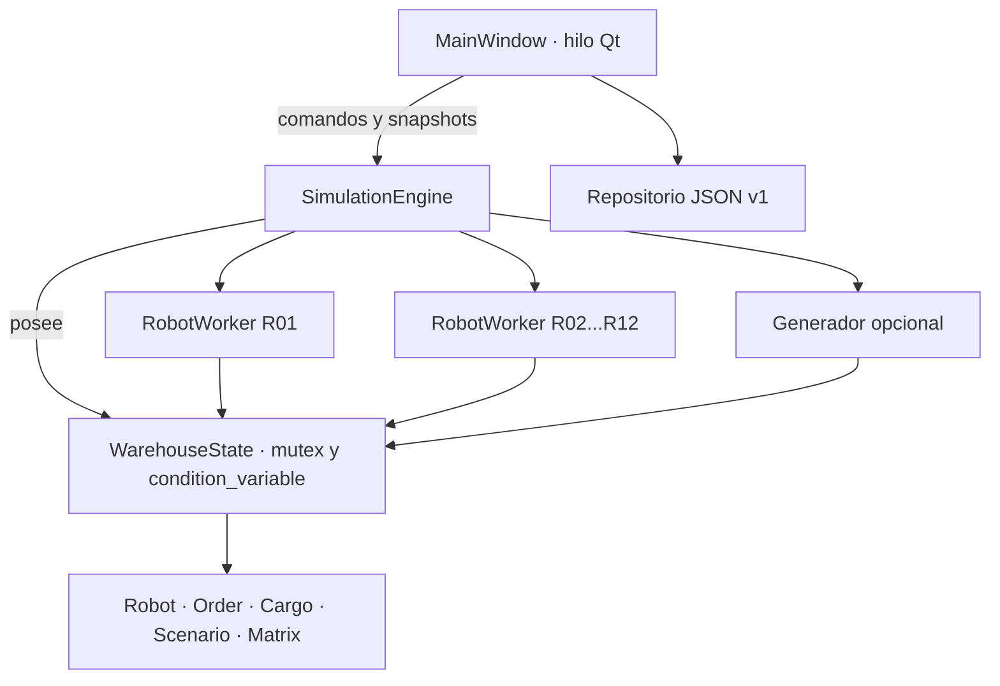

# Arquitectura verificable

La configuración `Scenario` es copiable; `WarehouseState` contiene la ejecución mutable y protege robots, pedidos, mercancía, estaciones, ocupación y métricas con un mutex. `SimulationEngine` posee un `std::thread` por robot y, opcionalmente, un hilo generador. `RobotWorker::operator()` implementa el ciclo de trabajo. Qt lee `Snapshot`, una copia consistente, cada 100 ms; ninguna llamada de Qt ocurre en los trabajadores.

## Invariantes y transacciones

- Una posición contiene a lo sumo un robot. `WarehouseState::move` valida adyacencia, terreno, ocupación, energía y reserva de cargador antes de actualizar posición, batería y métricas bajo un único lock.
- Un pedido se asigna a un único robot. `assign` copia las condiciones, calcula BFS fuera del lock y revalida versión, batería, robot, pedido y carga antes de reservar. El envejecimiento agrega un nivel de prioridad cada 30 segundos de espera, hasta urgente.
- Una carga tiene una ubicación lógica: estante, recepción, ID del robot o `DELIVERED`. `pickUp` y `deliver` cambian custodia bajo el mismo lock. La reposición comprueba espacio incluyendo reservas activas.
- Un cargador admite un solo propietario. La reserva no ocupa su celda. Se libera al salir de la celda de servicio. La compatibilidad de conectores se comprueba por la familia de productos de Abstract Factory.
- Pausa y parada son banderas protegidas por el mismo mutex usado por la variable de condición. `stop` notifica, los trabajadores salen cooperativamente y el motor hace `join` antes de destruir el estado.

## Ruta y espera

BFS usa `Matrix<uint8_t>` para terreno y visitas; devuelve `nullopt` si no existe ruta y un vector vacío cuando origen y destino coinciden. La ruta puede considerar ocupación dinámica; cada paso vuelve a validarse. Ante colisión, el trabajador espera una notificación o timeout, toma otro snapshot y replantea. La relación de espera robot→robot detecta ciclos de dos robots y los cuenta. Tras espera prolongada se muestra `Bloqueado` y se sigue reintentando; no se promete resolver toda congestión.

## Propiedad y memoria

`SimulationEngine` posee `WarehouseState` con `unique_ptr`; este posee robots, pedidos y productos de recarga polimórficos. Las referencias entre entidades son IDs. El destructor del motor llama a `stop()` y `join()`; no se usa `detach`. `Scenario::clone` copia configuración, sin estado de ejecución. El logger usa una instancia estática local con mutex propio y retiene como máximo 2000 eventos.
