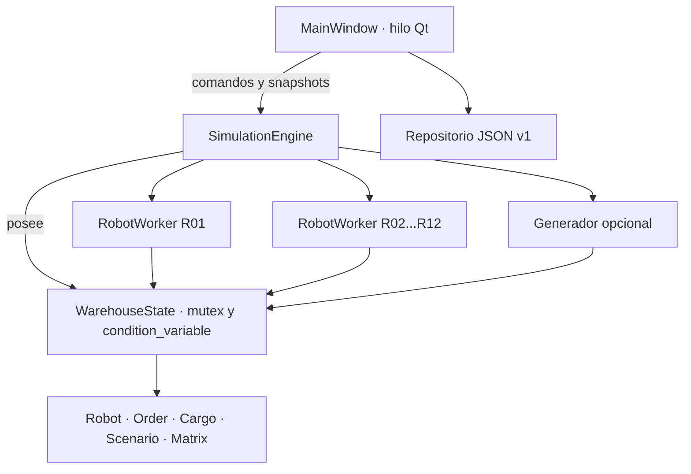

# Arquitectura verificable

SIMRA usa una arquitectura por capas con una presentación que controla el motor y dibuja sus snapshots. CMake hace explícitas las dependencias. `simra_core` reúne el dominio y la aplicación sin dependencias de Qt. `simra_json` usa Qt Core para persistencia. `simra_widgets` concentra la interfaz.

La configuración `Scenario` se copia como datos. `WarehouseState` protege robots, pedidos, mercancía, estaciones y métricas con un mutex. `SimulationEngine` posee un hilo por robot y puede añadir un generador. `MainWindow` coordina el ciclo de la sesión y distribuye snapshots a las vistas. Cada vista se concentra en mostrar sus propios datos. El generador y los robots trabajan con tipos de C++20.

[Diagrama de componentes en SVG](diagrams/componentes.svg) · [Estados del pedido en SVG](diagrams/pedido.svg). Ambos tienen fuentes DOT y copias PNG en la misma carpeta.

## Invariantes y transacciones

- Una posición contiene a lo sumo un robot. `WarehouseState::move` valida adyacencia, terreno, ocupación, energía y reserva de estación antes de actualizar posición, batería y métricas bajo un único lock.
- Un pedido se asigna a un único robot. `assign` copia las condiciones, calcula BFS fuera del lock y revalida versión, batería, robot, pedido y carga antes de reservar. El planificador guarda las celdas de servicio de recogida y entrega junto con la asignación. Antes de intentar un desvío, el trabajador verifica que quede energía para la tarea y para llegar a un cargador compatible. El envejecimiento agrega un nivel de prioridad cada 30 segundos de espera, hasta urgente.
- Una carga tiene una ubicación lógica: estante, recepción, ID del robot o `DELIVERED`. `pickUp` y `deliver` cambian custodia bajo el mismo lock. La reposición comprueba espacio incluyendo reservas activas.
- Cada estación admite un solo propietario. La reserva no ocupa su celda y se libera al salir de ella. La compatibilidad de cargadores se comprueba por la familia de productos de Abstract Factory.
- Pausa y parada son banderas protegidas por el mismo mutex usado por la variable de condición. `stop` notifica, los trabajadores salen cooperativamente y el motor hace `join` antes de destruir el estado.

## Ruta y espera

BFS usa `Matrix<uint8_t>` para terreno y visitas; devuelve `nullopt` si no existe ruta y un vector vacío cuando origen y destino coinciden. La ruta puede considerar ocupación dinámica; cada paso vuelve a validarse. Ante colisión, el trabajador espera una notificación o timeout, toma otro snapshot y replantea. La relación de espera robot→robot detecta ciclos de dos robots; el de mayor ID intenta ceder a una celda libre con ruta restante. Tras dos segundos lógicos de espera en ruta se muestra `Bloqueado`. Si hay carga, el pedido queda bloqueado en custodia hasta que el robot pueda retomar la entrega.

## Propiedad y memoria

`SimulationEngine` posee `WarehouseState` con `unique_ptr`; este posee robots, pedidos y productos de recarga polimórficos. Las referencias entre entidades son IDs. El destructor del motor llama a `stop()` y `join()`; no se usa `detach`. `Scenario::clone` copia configuración, sin estado de ejecución. El logger usa una instancia estática local con mutex propio y retiene como máximo 2000 eventos.
